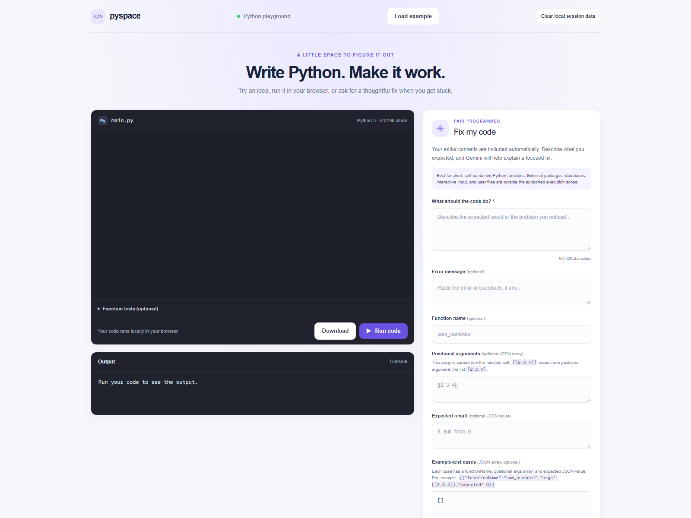

# Pyspace Python Playground

Pyspace is a browser-based Python playground. Edit `main.py` with Python
syntax highlighting, describe what you want the code to do, and run it in the
output console. Each run executes in a fresh Pyodide Web Worker hosted by a
sandboxed, opaque-origin iframe. The iframe's Content Security Policy permits
network access only to the app's public `/pyodide/` runtime assets; submitted
code cannot read the app page, cookies, browser storage, or other network
destinations. Messages crossing the iframe and worker boundaries are validated.
Use **Download** to save your code as `main.py`.

Use **Function tests (optional)** to call short functions with JSON-compatible
basic types. For example, with `def add(a, b): return a + b`, enter:

```json
[{"functionName":"add","args":[2,3]}]
```

The output panel shows the returned values. With no test cases, Run code sends
an explicit standalone-script request; with test cases, it sends a function
test request. Runtime initialization is limited to 30 seconds and execution to
five seconds. **Stop** cancels the active request and terminates its worker;
timeouts do the same. A later run gets a new iframe and worker, so Python
state is not shared between runs. Captured output is capped at 20,000
characters and reports when it was truncated.

### Example-test verification

After requesting a correction, **Example-test cases** lets you compare the
submitted and suggested code in separate clean workers. Each case has a
`functionName`, an `args` array containing positional arguments, and an
`expected` JSON value. The runner calls the function as
`functionName(*args)`: therefore `[[2,3,4]]` passes one list argument,
`[2,3,4]`, rather than three scalar arguments.

Expected values are labeled **user-provided**, **reviewed exercise**, or
**AI-suggested**. AI-suggested cases are not test targets until you explicitly
review and approve them. Each result shows the arguments, expected and actual
values, and any execution error for both versions. A run reports **Not
executed**, **Passed N example tests**, **Failed an example test**,
**Execution error**, or **Execution timed out**. Passing examples are useful
evidence, but do not prove complete correctness. If the function name or
argument shape is ambiguous, confirm it before relying on a test.

The **Fix my code** action uses the `/api/fix` Gemini endpoint. Set
`GEMINI_API_KEY` in the server environment (or your hosting provider's
environment-variable settings) before starting or deploying the app; the key
is never sent to the browser. Code and intended behavior are required; optional
context includes an error message, JSON-array example arguments, and a
JSON-encoded expected result. The tool is intended for short, self-contained
Python functions; external packages, databases, interactive input, and user
files are outside the supported execution scope. If intended behavior is
unclear, the app asks a follow-up question. Suggested corrections are not
executed automatically; review the highlighted diff, then copy the correction,
apply it, or restore and edit the submitted code. Failed requests show a
readable error and a **Retry** action. **Load example** fills the editor and
context fields with a broken accumulator demo (`[[2, 3, 4]]` should return
`9`).

### Explanation narration

Use **Listen**, **Stop**, and **Replay** beside a suggested correction's written
explanation. Audio is generated on demand by the server-side `/api/speak`
endpoint and cached in the page only for replay; changing or removing the
explanation releases that audio. Audio failures do not affect code correction or
practice. The endpoint requires `ELEVENLABS_API_KEY`; optionally set
`ELEVENLABS_VOICE_ID` to select a voice. Text is limited to 3,000 characters.
There is currently no revealed-hint UI, so narration is available for correction
explanations only.

### Public-use limits and account spending controls

The server shares one limit across correction and narration: 10 paid requests
per visitor IP in each hour. Production uses an atomic shared Upstash Redis REST
counter. Configure `UPSTASH_REDIS_REST_URL` and `UPSTASH_REDIS_REST_TOKEN` on the
server; if the shared limiter is missing or unavailable, paid endpoints fail
closed rather than silently allowing unlimited requests. Local development
uses a process-local counter. Requests over the cap receive HTTP 429 and a
`Retry-After` header. The editor, inputs, and results remain in the page when a
paid request fails.
The counter key uses a hash of the visitor IP supplied by the hosting proxy;
deploy behind an ingress that overwrites client-supplied `X-Real-IP` and
normalizes `X-Forwarded-For`. People sharing a public IP also share one limit.

This app-side cap is not a spending guarantee. Also configure Gemini API quotas
and budget/alert controls in the Google AI account, and usage limits/budget
alerts in the ElevenLabs account. Provider-side controls remain necessary
because credentials can be used outside this app and provider billing policies
can change.

### Data, privacy, and session clearing

- Python runs in the browser using Pyodide in a Web Worker behind a sandboxed,
  opaque-origin iframe. Submitted Python is not sent to either AI provider when
  you simply run it.
- **Fix my code** sends the submitted Python code and intended behavior to
  Gemini. Optional function name, example arguments/expected value, traceback,
  and clarification answers are sent when supplied. Gemini generates the
  correction and explanation. The app logs failure category and error type,
  not submitted code or provider credentials.
- **Listen** sends the explanation text to ElevenLabs for speech generation.
  The app sends no API credential to the browser. Provider retention and
  processing are subject to the configured accounts' terms.
- Practice-attempt history is not enabled in this app yet. The SQL migration is
  only a schema artifact; there is no active save/history endpoint or database
  connection, and no attempts are currently stored by the app.
- The app does not write editor content or results to browser storage. **Clear
  local session data** resets the current page's unsaved code, inputs,
  correction, and execution results. It does not remove downloaded files and
  does not delete server-side records. Since persistent attempt history is not
  enabled, there are currently no saved attempts to clear.

## Run locally

Install dependencies and start the development server:

```bash
npm install
npm run dev
```

Open [http://localhost:3000](http://localhost:3000) with your browser to see the result.

The pinned Pyodide 314.0.7 runtime and its matching assets are included in the
deployment under `public/pyodide`. To use **Fix my code** and narration, add
the API keys to `.env.local`:

```dotenv
GEMINI_API_KEY=your-gemini-api-key
ELEVENLABS_API_KEY=your-elevenlabs-api-key
# Optional; defaults to ElevenLabs' Rachel voice.
ELEVENLABS_VOICE_ID=21m00Tcm4TlvDq8ikWAM
```

These keys are only used by server-side API routes; never expose them in
client-side code. `.env.local` is ignored by Git.

For production paid endpoints, configure a shared Upstash Redis REST database
and add its HTTPS URL and token:

```dotenv
UPSTASH_REDIS_REST_URL=https://your-database.upstash.io
UPSTASH_REDIS_REST_TOKEN=your-upstash-rest-token
```

Never commit real credentials. Use your deployment platform's encrypted
environment-variable settings for production.

## Deploy on Vercel

In the Vercel project settings, clear **Root Directory** completely (no spaces)
to use the repository root. Open **Settings → Environment Variables** and add
the provider secrets there, selecting the environments where the app will run:

- `GEMINI_API_KEY` — enables code correction.
- `ELEVENLABS_API_KEY` — enables narration. Keep this value server-side; do not
  add it to a `NEXT_PUBLIC_` variable or an in-app form.
- `ELEVENLABS_VOICE_ID` — optional voice selection; defaults to the voice ID
  documented above. Voice IDs are not credentials.
- `UPSTASH_REDIS_REST_URL` and `UPSTASH_REDIS_REST_TOKEN` — required for the
  production shared paid-request limit.

Save the variables and redeploy. Vercel injects them into server-side route
handlers; `/api/speak` does not send the API key back to the browser. Local
`.env.local` values are not automatically uploaded to Vercel. Do not paste
provider secrets into chats, source code, screenshots, or public build-time
configuration.

## Supported scope and limitations

Pyspace is intended for short, self-contained Python exercises and JSON
function tests. Python runs with a fresh isolated worker for each run, with a
30-second initialization limit, five-second execution limit, and 20,000
character output cap. It is not a general-purpose Python host: interactive
input, arbitrary network access, local files, external packages, and persistent
Python state are not supported. The sandbox is defense-in-depth, not a
replacement for operating-system isolation in a server-side code runner.

AI corrections and narration require their respective provider credentials
and can be unavailable due to account quotas, configuration, or network
failures. Example tests cover only the examples shown and do not prove complete
correctness. Persistent learner history and recommendations are not yet
available.

## Architecture

```text
Browser editor ── Pyodide ── sandboxed iframe ── fresh Web Worker
       │
       ├── /api/fix ── shared paid-request limit ── Gemini
       └── /api/speak ─ shared paid-request limit ── ElevenLabs

Local development uses an in-process request counter. Production requires
Upstash Redis REST for one atomic, shared hourly limit across both endpoints.
```

## Screenshots and project links



- Local demo: <http://localhost:3000>
- Public demo and source repository: not configured in this workspace.

The npm deprecation and install-script messages shown during installation are
warnings. They do not explain a starter page appearing after deployment.

## Learn More

To learn more about Next.js, take a look at the following resources:

- [Next.js Documentation](https://nextjs.org/docs) - learn about Next.js features and API.
- [Learn Next.js](https://nextjs.org/learn) - an interactive Next.js tutorial.

You can check out [the Next.js GitHub repository](https://github.com/vercel/next.js) - your feedback and contributions are welcome!

For more details, see the [Next.js deployment documentation](https://nextjs.org/docs/app/building-your-application/deploying).
